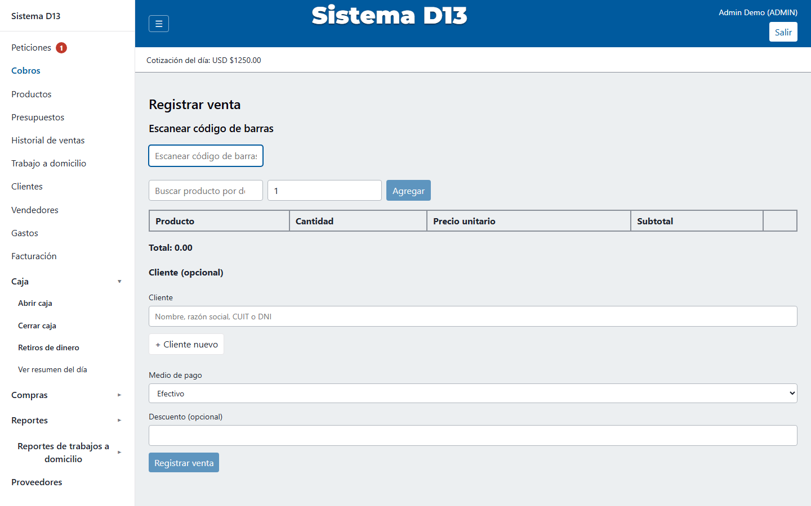
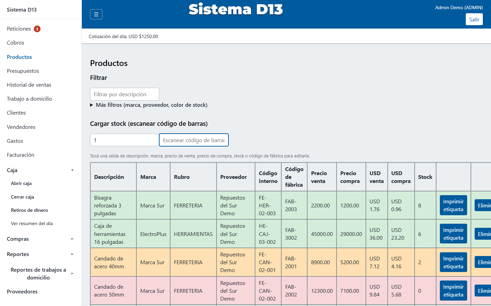
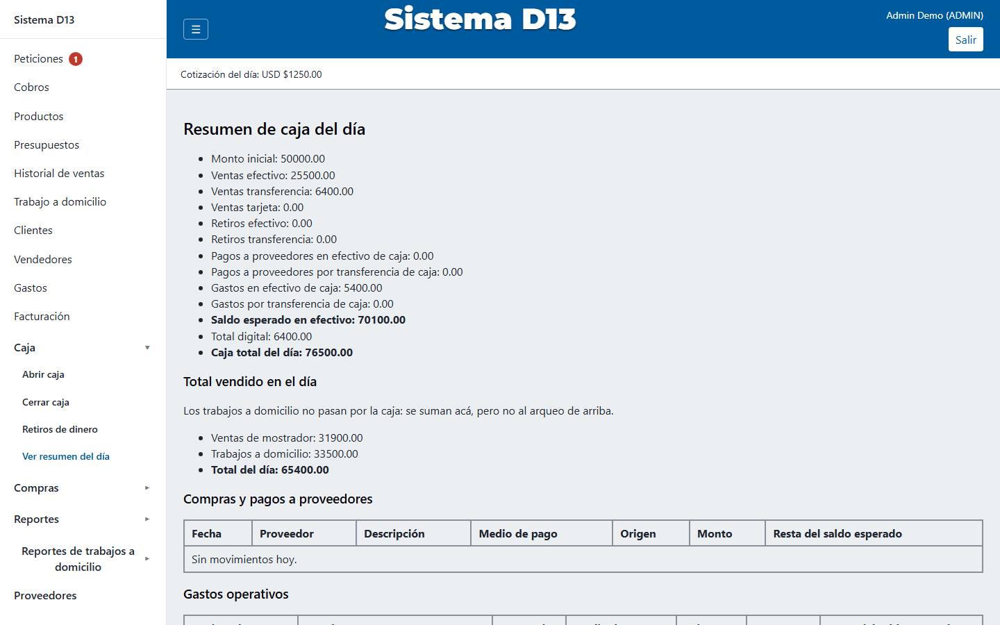
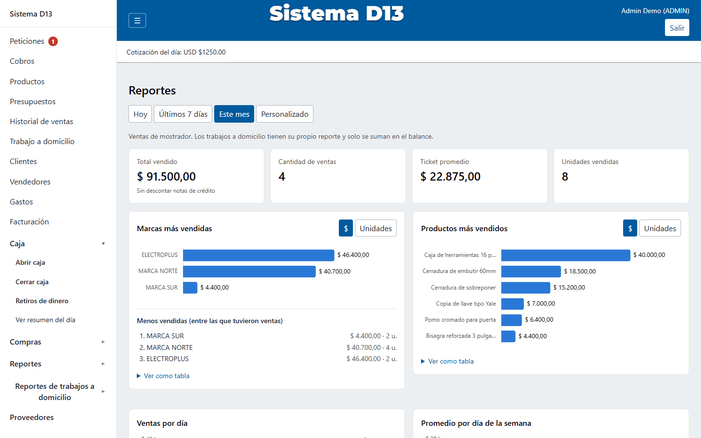
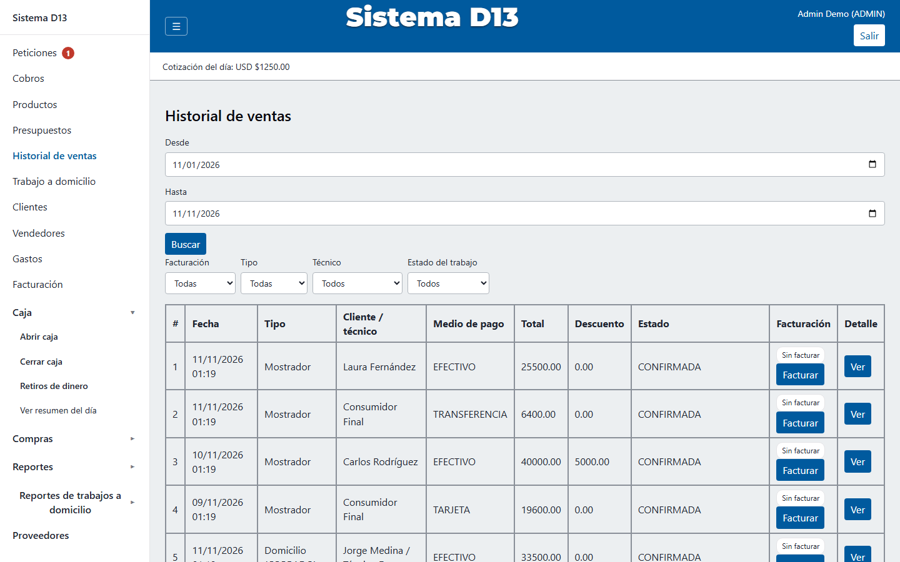
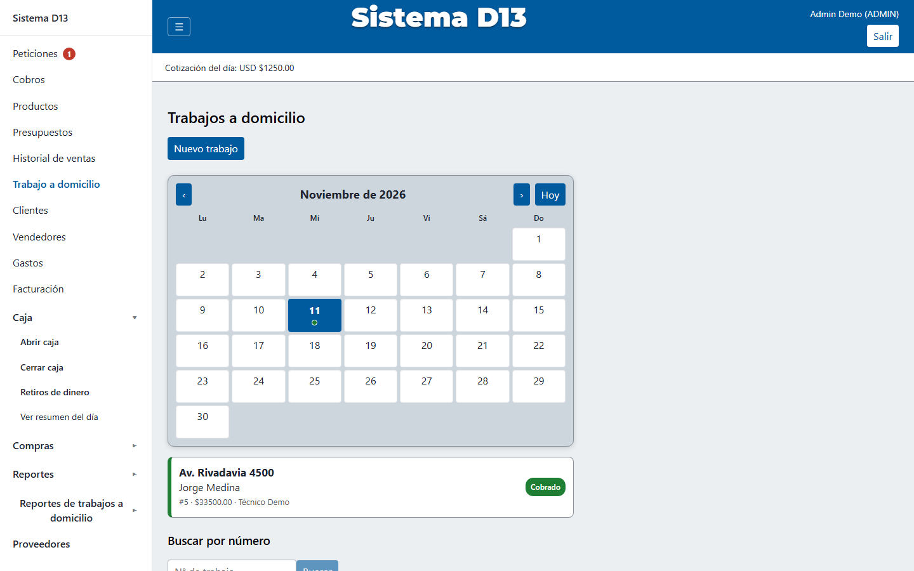
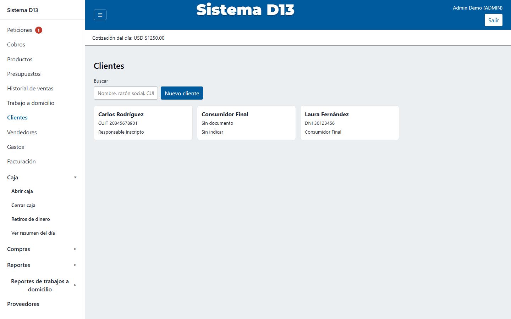
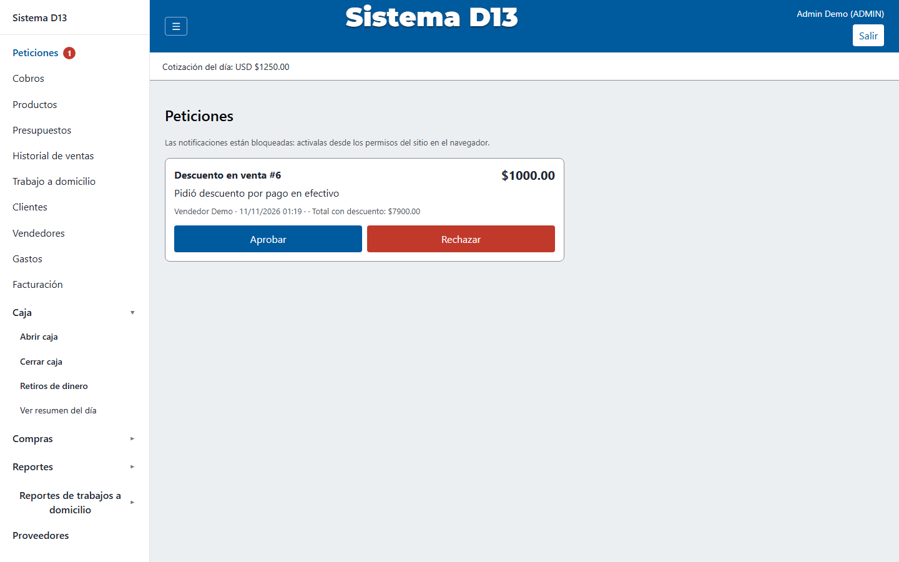
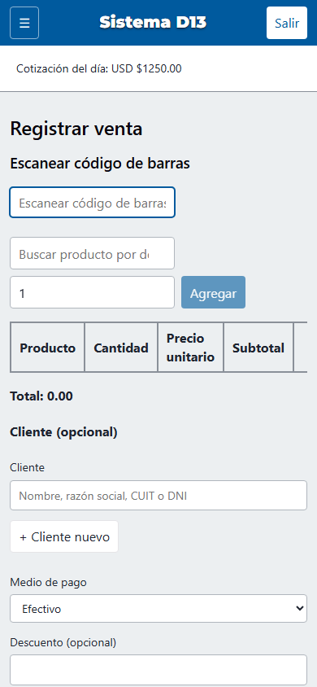
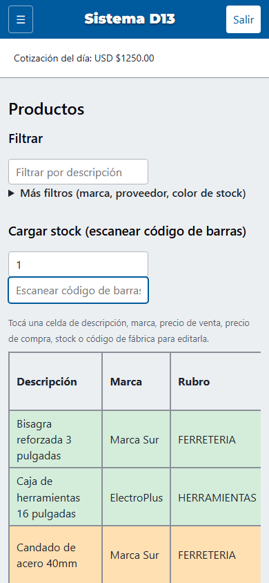

# Sistema D13

Sistema de gestión (ERP liviano) para un comercio real de ferretería/cerrajería en Buenos Aires,
Argentina: ventas, caja, stock, compras, proveedores, clientes, facturación fiscal ante AFIP/ARCA,
trabajos a domicilio con técnicos, y reportes. Nació como una app de escritorio en JavaFX y fue
migrado en vivo — sin frenar el negocio — a una arquitectura web moderna: **Spring Boot (API REST)
+ React (SPA) + PostgreSQL**.

> 🔗 **Demo online**: **https://sistema-d13-demo.vercel.app** — usuario `admin` / contraseña `demo1234`
> (o `vendedor` / `demo1234` para ver los permisos acotados de ese rol). Backend real corriendo en
> Railway con datos 100% inventados (H2 en memoria, se resetea solo en cada redeploy) — facturación
> AFIP deshabilitada a propósito, no tiene forma de tocar ARCA real. Nada de esto expone datos del
> negocio real.
>
> 📸 Las capturas de abajo son de esa misma demo (ver también [Demo local](#demo-local-con-datos-inventados)
> para correrla en tu máquina).

## Qué resuelve

El negocio operaba con un sistema de escritorio viejo (JavaFX + SQLite) que no era accesible desde
el celular ni desde más de una PC a la vez, no emitía comprobantes fiscales electrónicos (el
negocio es Monotributo y necesita facturar ante AFIP/ARCA), no tenía control real de caja ni
cuentas corrientes, y no soportaba el flujo de "trabajo a domicilio" (reparaciones con técnico
asignado). El sistema actual digitaliza y controla **todo el circuito de caja de un comercio
real**: desde que un cliente compra o pide un trabajo, hasta que se factura, se cobra, se repone
stock y se cierra la caja, con reportes gerenciales y comisiones calculadas automáticamente.

## A quién está orientado

Pensado para **comercios chicos/medianos con mostrador y caja física** que necesitan control
interno (evitar descuentos o retiros no autorizados) sin la complejidad de un ERP corporativo.
Tres roles con permisos reales (impuestos en el backend, no solo ocultos en la UI):

| Rol | Qué puede hacer |
|---|---|
| **ADMIN** (dueño) | Todo: historial completo, reportes y balance, autorizar retiros/descuentos, ABM de productos/marcas/proveedores/clientes/empleados, facturación fiscal, trabajos a domicilio. |
| **VENDEDOR** (mostrador) | Abrir/cerrar caja, vender, cobrar, y pedir autorización para un retiro o un descuento (el ADMIN aprueba o rechaza). No ve historial, caja de otros turnos ni reportes. |
| **TÉCNICO** | No inicia sesión — es una categoría de empleado asignable a trabajos a domicilio, cobra comisión solo sobre su mano de obra. |

## Capturas

| | |
|---|---|
| **Cobros** (venta de mostrador) | **Productos** (código de colores por stock) |
|  |  |
| **Caja** (arqueo del día) | **Reportes** (gráficos con Chart.js) |
|  |  |
| **Historial de ventas** | **Trabajo a domicilio** (agenda) |
|  |  |
| **Clientes** (cuenta corriente) | **Peticiones** (autorización en dos pasos) |
|  |  |

<details>
<summary>Responsive / uso desde el celular</summary>

| Cobros (390px) | Productos (390px) |
|---|---|
|  |  |

La interfaz es responsive y se probó puntualmente en ancho de celular en las pantallas operativas
clave. Es instalable como PWA y manda notificaciones push reales al celular (stock bajo, pedidos
de autorización pendientes) sin tener el navegador abierto.
</details>

## Arquitectura

Monorepo con dos proyectos que se comunican por REST:

```
sistema-Caja-D13-1.5/
├── backend/   → Spring Boot (Java), API REST + JWT, Maven
├── frontend/  → React + Vite (TypeScript), SPA
```

- **Backend**: API REST stateless con JWT, capas controller → service → repository (Spring Data
  JPA) → PostgreSQL, seguridad declarativa por endpoint (`hasRole`/`hasAnyRole`).
- **Frontend**: SPA en React con rutas protegidas por rol.
- **Base de datos**: PostgreSQL en Supabase. Sin generación automática de esquema en producción
  (`ddl-auto=validate`) — los cambios de esquema se revisan y corren a mano como SQL.
- **Deploy**: backend en Railway, frontend en Vercel, base de datos en Supabase.
- **Integración fiscal real con AFIP/ARCA** (WSAA + WSFEv1): sobres SOAP armados y firmados a
  mano con BouncyCastle (CMS/PKCS7), sin generar stubs de WSDL, corriendo contra el ambiente de
  **producción** real de ARCA (el negocio es Monotributo, sin homologación).
- **PWA + Web Push** (VAPID) para notificaciones al celular sin navegador abierto.
- **+380 tests automáticos** (JUnit/Mockito, H2 en memoria) como gate de calidad en cada entrega.

## Tecnologías

**Backend**: Java · Spring Boot 3 (Web, Data JPA, Security, Validation) · PostgreSQL/Hibernate ·
JWT (jjwt) · BouncyCastle (firma AFIP) · openhtmltopdf + PDFBox (PDFs) · ZXing/jsbarcode (códigos
de barra) · JUnit 5 + Mockito + H2 · Maven.

**Frontend**: React 19 + TypeScript + Vite · React Router · Chart.js · PWA (manifest + service
worker) + Web Push · oxlint.

**Infraestructura**: Railway (backend) · Vercel (frontend) · Supabase (PostgreSQL) · AFIP/ARCA
(WSAA + WSFEv1) · Resend (emails vía API HTTPS) · APIs públicas de cotización del dólar oficial.

## Módulos funcionales

- **Núcleo de venta y caja**: login JWT por rol, apertura/cierre de caja con arqueo, cobros de
  mostrador, autorización en dos pasos para retiros y descuentos (el VENDEDOR pide, el ADMIN
  aprueba o rechaza), historial de ventas.
- **Catálogo y abastecimiento**: productos (ABM, edición en línea, código de barras, colores de
  stock), marcas, proveedores (con cuenta corriente propia), compras (ARS/USD, medio de pago y
  origen), dolarización de precios con cotización diaria.
- **Clientes y facturación**: catálogo de clientes con cuenta corriente auditable, facturación
  fiscal real ante AFIP/ARCA (Factura C), notas de crédito con emisión fiscal propia, comprobantes
  no fiscales (ticket/remito) con diseño para impresora térmica 58mm.
- **Trabajos a domicilio**: agenda con calendario, artículos de catálogo + mano de obra, técnico
  asignado, comisión separada solo sobre la mano de obra.
- **Gestión y reportes**: empleados con % de comisión, gastos operativos, balance financiero,
  ventas por marca/día/forma de pago, ranking de productos, comisiones por vendedor — todo con
  gráficos (Chart.js) y filtro global de fechas.

## Demo local (con datos inventados)

El backend tiene un perfil **`demo`** que corre contra una base H2 en memoria, sin necesitar
Supabase ni ningún secreto real, poblada con datos 100% inventados (`backend/src/main/resources/sql/demo-data.sql`):
ninguna información del negocio real. AFIP queda deshabilitado a propósito en este perfil (no hay
forma de que la demo le pegue a ARCA real).

```bash
# Backend (perfil demo, con H2 en memoria)
cd backend
mvn spring-boot:run -Dspring-boot.run.profiles=demo

# Frontend, en otra terminal
cd frontend
npm install
npm run dev
```

Abrí `http://localhost:5173` y entrá con:

| Usuario | Contraseña | Rol |
|---|---|---|
| `admin` | `demo1234` | ADMIN |
| `vendedor` | `demo1234` | VENDEDOR |

## Correrlo contra una base real

Requiere variables de entorno (`SUPABASE_DB_PASSWORD`, `JWT_SECRET`, credenciales de AFIP, etc. —
ver `backend/src/main/resources/application.properties`) que no se commitean. Pensado para
`backend/` (Maven) + `frontend/` (`npm run dev`), con PostgreSQL real detrás.

## Decisiones técnicas destacadas

- Facturación electrónica AFIP/ARCA implementada desde cero, sin stubs de WSDL, verificada
  contra el manual oficial de WSFEv1.
- Seguridad por rol de punta a punta (backend y frontend), con flujo de autorización en dos pasos
  para operaciones sensibles.
- Ledger auditable para cuentas corrientes (clientes y proveedores): nunca un saldo suelto, siempre
  recalculado desde el historial de movimientos.
- Migración completa de una app de escritorio a arquitectura web sin interrumpir el uso real del
  negocio, con +380 tests automáticos como red de seguridad.

## Licencia

Proyecto personal. No tiene una licencia abierta — si te interesa reusar algo del código, escribime.
